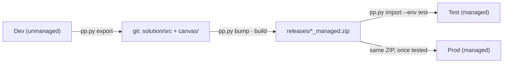

# Application lifecycle (ALM)

How a solution moves from a maker's screen to production, and the rules that keep each environment
predictable.

## 1. Environments

| Environment | Purpose | Package | Who changes it |
|---|---|---|---|
| **Dev** | Makers build here, inside the solution | Unmanaged | Acies makers |
| **Test** | The release candidate, tested by people | Managed | Imports only |
| **Prod** | Users | Managed | Imports only |

Each needs a Dataverse database (PA-T15). Each has its own SharePoint site (or at least its own
lists), so testing never touches production data. One developer can use a personal developer
environment as Dev and import the unmanaged ZIP to share work.

## 2. Versioning

`Major.Minor.Build.Revision`, in `solution/src/Other/Solution.xml`, raised by `pp.py bump`.

| Part | Raise when | Command |
|---|---|---|
| Major | A breaking change: lists restructured, components removed, a new data model | `bump --part major` |
| Minor | A release with new features | `bump --part minor` |
| Build | Each release candidate built for Test (default) | `bump` |
| Revision | A hotfix on a released version | `bump --part revision` |

Every import into Test or Prod needs a version higher than the one there (PA-T11). The ZIP name
carries the version (`Name_1_2_3_0_managed.zip`); git commits and PROJECT.md §4 record it. Never
rebuild an existing version number with different content.

## 3. Managed and unmanaged

| | Unmanaged | Managed |
|---|---|---|
| Goes to | Dev only | Test, Prod, any other environment |
| Editable there | Yes | No (editing creates an active layer, PA-T10) |
| Deleting the solution | Leaves the components behind | Removes the components |
| Removes deleted components on upgrade | No | Yes, with `--upgrade` (stage and upgrade) |

`pp.py build` packs both from the same source with SolutionPackager. Microsoft's recommended path
for production is a managed package **exported from a build environment** (`pac solution export
--managed`, or Power Platform Pipelines). The packed managed ZIP is the same content; if a client's
governance requires the exported one, import the unmanaged ZIP into a clean build environment and
export it managed.

## 4. Environment variables

| Type | Use for | Value per environment |
|---|---|---|
| Data source (SharePoint site) | The site the app's lists live on | Site URL |
| Data source (SharePoint list) | Each list, as a child of the site variable | List ID |
| Text | Email addresses, URLs, labels a business user may change | The text |
| Number / Yes-No / JSON | Thresholds, switches, small structured settings | The value |
| Secret | — | Not used: needs Azure Key Vault (D3, D7) |

Rules: definitions in the solution, **values never** (PA-T4). One variable per thing, never per
environment (PA-T2). A flow reads a variable as `@parameters('Display name (schema_name)')`; a canvas
app gets data-source variables automatically when they're on (PA-T13). Canvas apps can't read *text*
variables without the Dataverse connector, which would make the app premium; put such settings in a
SharePoint configuration list instead (D8), or pass them from a flow.

## 5. Connection references

One per connector (PA-T3), named `<prefix>_<connector>`. A reference names the connector; each
environment binds it to a **connection**. In Test and Prod, bind them to the service account's
connections (PROJECT.md Q-01), so the flows don't stop when a person leaves.

Bind by: the import wizard's *Connections* step (the default); or afterwards, in the solution → the
reference → edit; or, for scripted imports, `deployment/settings.<env>.json` (`pac connection list`
gives the IDs, PA-T16).

## 6. Deployment settings files (optional)

**The deliverable is the solution ZIP.** The person importing it chooses the variable values and
connections in the portal's import wizard, so these files are not needed. Use them only to script
imports (`pp.py import`).

`pac solution create-settings` writes the template (`pp.py settings` regenerates it from the latest
build). Copy each new entry into `settings.dev.json`, `settings.test.json` and `settings.prod.json`,
then fill the values. `pp.py import` refuses to import while any value for that environment is blank.

They hold environment facts (site URLs, list IDs, connection IDs), not secrets. They may be
committed in a private repository. If a client classes its site URLs as confidential, keep only the
template in git and the filled files on the project's SharePoint site.

## 7. The release routine

| Step | Command | Check |
|---|---|---|
| 1. Bring Dev into source | `pp.py export` | `git diff` reads as the intended change |
| 2. Version | `pp.py bump` | |
| 3. Build | `pp.py build` | 0 errors |
| 4. Settings (only for scripted imports) | `pp.py settings --env test` | 0 errors |
| 5. Solution checker | `pp.py check` | No critical or high issues |
| 6. Test | Portal import of the managed ZIP (or `pp.py import --env test --activate`), choose values, turn flows on | Tests pass; PROJECT.md §7 updated |
| 7. Production | The same ZIP, same steps | Smoke test; PROJECT.md §7 updated |
| 8. Commit and tag | `git tag v1.2.3.0` | |

## 8. Automating it

Everything above runs from the command line, so a pipeline can run it unchanged. Options, in order of
effort:

| Option | Fits when |
|---|---|
| **Power Platform Pipelines** (in the product) | The client wants deployment inside Power Platform, with approvals, and has managed environments |
| **GitHub Actions** (`microsoft/powerplatform-actions`) | The repository is on GitHub; authenticate with a service principal (an app registration with an application user in each environment) |
| **Azure DevOps** (Power Platform Build Tools) | The client runs Azure DevOps |

A pipeline authenticates as a service principal, which needs an app registration and an application
user in every environment: a tenant change, so it needs the client's admin and a decision in
PROJECT.md §5. Until then, people run the commands.
