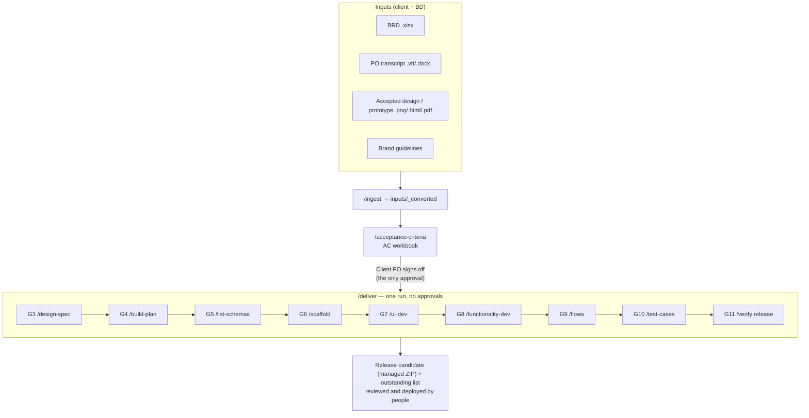

# The delivery pipeline

How a Power Apps project goes from signed-off acceptance criteria to a release candidate, with Claude
Code doing the drafting and people doing the deciding.

**Before** (manual): prototype → screens built by hand in Studio → flows wired by hand → a solution
exported from whatever the environment held, every project from scratch.

**Now**: one decision fixes the scope: the client's PO signs off the acceptance criteria. Everything
after that, from design spec to a managed solution ZIP, is drafted in **one run** (`/deliver`), with no
approvals in between. People review the result as a whole.

**The accepted prototype is the UI's specification** (CLAUDE.md §7, [prototype-fidelity.md](standards/prototype-fidelity.md)): it is
inventoried at G1, mapped to criteria at G2, translated into native controls at G7–G8 and compared
with the built app before release. It is translated, never redesigned.

## Stages

| Stage | Name | Skill | Reads | Writes | Done when |
|---|---|---|---|---|---|
| G0 | Set up | `/project-setup` | — | `PROJECT.md`, renamed solution, the project's README | Starter builds (`pp.py build`); names, prefixes, tenant facts filled or 🔶; reuse catalogue readable; committed |
| G1 | Ingest | `/ingest` | `inputs/**`, the Figma file (`specs/figma.json`) | `inputs/_converted/`, `specs/prototype-fidelity.md`, reuse suggestions (PROJECT.md §8) | Every input converted; `SUMMARY.md` lists the gaps (a *prototype gap* when the look can't be measured); every view, control, validation, message, action and state of the prototype is in the register |
| **G2** | **Acceptance criteria** | `/acceptance-criteria` | converted BRD, transcript, design | AC workbook | **The Client PO signs off**: every BRD requirement is covered; each check is right; every `ASSUMPTION` answered |
| G3 | Design spec | `/design-spec` | design, branding, AC | `specs/design-spec.md`, tokens in `App.Formulas`, `specs/visual-map.json` | Tokens applied; contrast computed for every pair; build passes |
| G4 | Build plan | `/build-plan` | AC, design spec, reuse catalogue | `specs/build-plan.md` | Every live AC ID is in §1 or §8; only allowed connectors; a reuse decision for every screen and flow (§1.1) |
| G5 | List schemas | `/list-schemas` | build plan, AC | `schemas/*.csv`, `specs/data-model.md`, list env vars | `check_schemas.py` 0 errors; archival and permissions written; settings files list every variable |
| G6 | Scaffold | `/scaffold` | build plan, schemas, starter | screens, components, solution wiring | Builds; every screen exists; samples gone |
| G7 | UI | `/ui-dev` | prototype, register, design spec, AC | screens on sample data | The prototype translated, not redesigned: every register row `Built` or a recorded `Deviation`; built with `ui-patterns.md` / `canvas_ui.py` or cloned from the reference app; every state and width; colours are tokens; build passes; opened in Studio |
| G8 | Functionality | `/functionality-dev` | AC, data model | formulas against the lists | No sample data left; every live AC traced in YAML or flows |
| G9 | Flows | `/flows` | build plan, data model | `solution/src/Workflows/` | Build passes; standard connectors only; variables and references only |
| G10 | Test cases | `/test-cases` | AC | *Test Cases* sheet | Every live check has a test; workbook check 0 errors |
| G11 | Release candidate | `/verify release` | everything | managed + unmanaged ZIPs in `releases/`, `specs/release-notes.md`; catalogue entries (`/deliver`) | Every check green; version bumped; known issues listed; ZIPs committed |

G0–G2 run one at a time. `/deliver` runs G3–G11 in the order above; each skill can also be run on its
own afterwards (say, `/ui-dev scrApprovals` after a design change).

## The rules

1. **One approval.** Only G2 needs a person: the Client PO signs off the workbook (Read Me →
   *Approved by / on*) and PROJECT.md §2 records it as `Name · YYYY-MM-DD`. Claude never signs it off.
2. **Nothing after G2 starts before sign-off.**
3. **After sign-off, `/deliver` runs without stopping.** It marks each stage *Done*, commits it
   (`G4: build plan`) so any stage can be compared later, and moves on. It stops only for a real
   blocker (CLAUDE.md §3 rule 5) and resumes from where it stopped.
4. **Every stage ends with its own checks green** before it is marked *Done*.
5. **Steps that need a person don't stop the run; they go on the outstanding list:** importing the
   lists, importing the solution into Dev, opening the app in Studio and binding the lists, walking the
   checks, comparing the screens with the design, turning flows on, executing the tests. `/deliver` ends
   with that list.
6. **People review the release candidate as a whole**, with the outstanding list, before anyone deploys.

## Where Claude's work meets Studio

Claude writes the app as YAML source and `pp.py build` turns it into a solution ZIP. Three things only
Power Apps Studio can do, so they are on every outstanding list:

| Step | When | Why |
|---|---|---|
| **Open the app in Studio, Save, Publish** | After every import of a YAML-packed app | Studio compiles the YAML; users can't run it before (PA-T8) |
| **Add each list as a data source** (from inside the solution, *automatically create environment variables* on) | Once per list, after G8's first import | Binding a list writes connection and data-source metadata that only Studio produces (PA-T13). G8's formulas already use the list names, so they resolve the moment the list is added |
| **`pp.py export`** after those | Then commit | Source then holds the Studio-saved app, which is what later builds start from |

## When something changes after sign-off

Requirements change. The pipeline keeps the change visible rather than letting it leak in.

| What changed | What happens |
|---|---|
| An input file (new BRD version, new design export) | `/ingest` notices the hash changed. `/status` marks every *Done* stage built from it as *Reopened* |
| The PO alters a criterion | It goes in the workbook as *Changed*, with a dated *Alterations* line. `/status` lists the screens, flows, lists and tests that cite that AC ID |
| A developer finds the AC wrong or impossible | Raise it in PROJECT.md §4 Open questions. Don't build around it silently |
| The design changes after G7 | Re-run `/design-spec` (tokens update in one place), then `/ui-dev` for the affected screens only |
| Someone changed the app in Studio | `pp.py export`, review the diff, commit. That is the source now |

`/deliver` re-runs *Reopened* stages, in order, for the affected scope only, then cuts a new release
candidate.

## What Claude does, and what it doesn't

| Claude does | People do |
|---|---|
| Drafts the acceptance criteria, citing its sources | Sign them off (the Client PO) |
| Runs G3–G11 end to end after sign-off | Review the release candidate as a whole, and own it once merged |
| Flags every assumption and open question | Answer them |
| Writes YAML and flows that pass `pp.py build`, traced to AC IDs | Open the app in Studio, bind the lists, walk the checks, run the tests |
| Writes list schemas, variables and references | Create lists and connections in real environments; choose the variable values in the import wizard |
| Builds the solution ZIPs | Import them, turn the flows on, share the app |
| Refuses to start delivery before sign-off | Decide when to override, and record why |
| Stops at a hard rule (premium connector, Azure, secret) and proposes a compliant alternative | Approve exceptions in PROJECT.md §3/§5 |

Claude never imports into a client environment unasked, never into Production, never grants
permissions, never emails a client, and never signs off the acceptance criteria.
